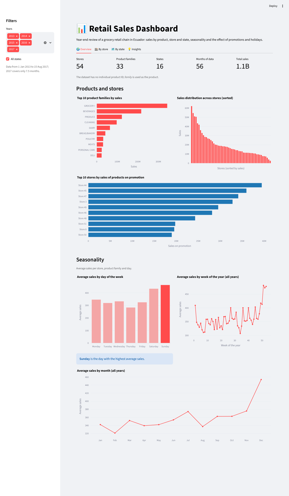
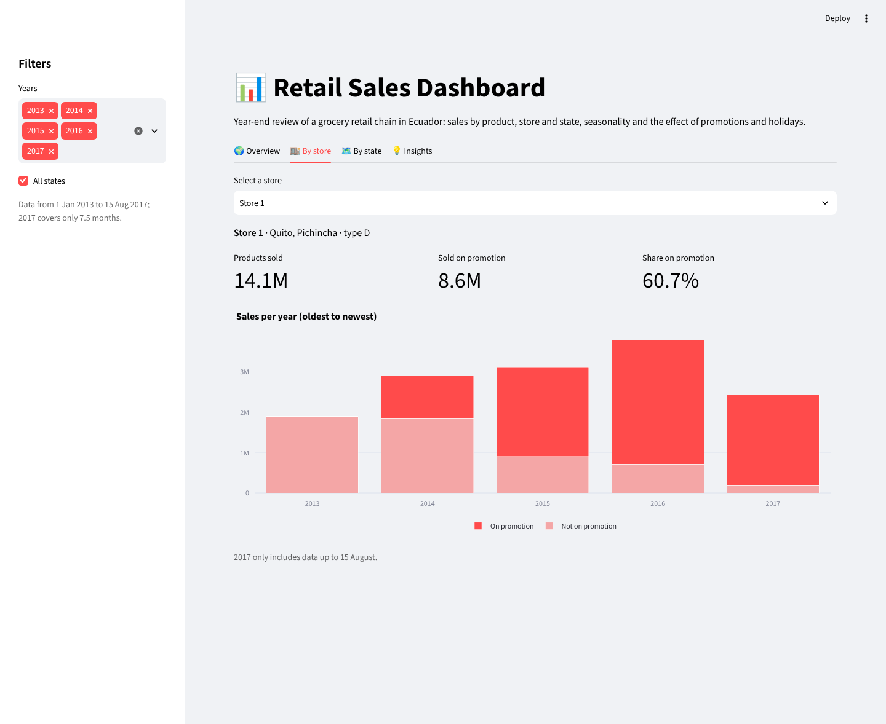
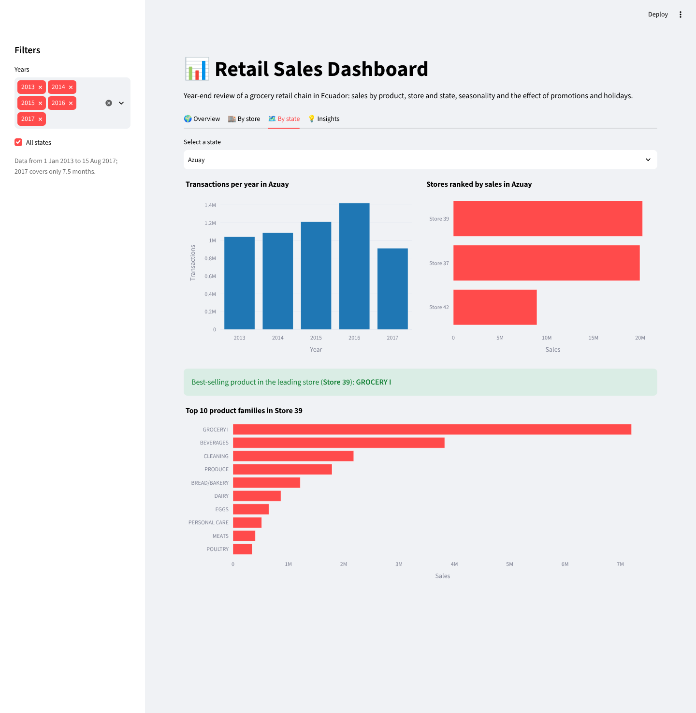
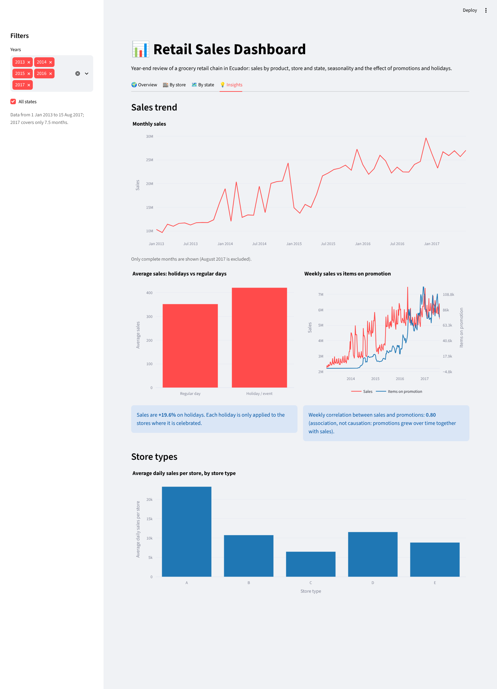

[English](README.md) | **Español**

# Dashboard de ventas retail

Dashboard interactivo en **Streamlit** con los KPIs de ventas de una cadena de supermercados de Ecuador: **54 tiendas, 33 familias de productos y 16 provincias, de enero de 2013 a agosto de 2017** (3 millones de registros diarios). Está pensado como revisión de cierre de año para el CEO y el jefe de ventas.

### 👉 [Abrir el dashboard en directo](https://jimenazubii-retail-sales.streamlit.app)

> Proyecto final individual de *Visualización de Datos*, 2º curso del Grado en Ingeniería Matemática e Inteligencia Artificial, ICAI – Universidad Pontificia Comillas (curso 2025/26).


<p align="center">
  
</p>

---

## Qué muestra el dashboard

Los filtros globales de la barra lateral (años y provincias) se aplican a todas las pestañas. La interfaz está en inglés.

| Pestaña | Contenido |
|---|---|
| 🌍 **Overview** | Número de tiendas, familias de productos, provincias y meses · top 10 productos · distribución de ventas entre tiendas · top 10 tiendas por ventas en promoción · estacionalidad por día de la semana, semana del año y mes |
| 🏬 **By store** | Selector de tienda · productos vendidos en total y en promoción · ventas anuales separadas según promoción |
| 🗺️ **By state** | Selector de provincia · transacciones por año · ranking de tiendas · productos más vendidos de la tienda líder |
| 💡 **Insights** | Tendencia mensual de ventas · festivos frente a días normales · ventas semanales frente a promociones · rendimiento por tipo de tienda |

<p align="center">
  
  
  
</p>

## Conclusiones principales

- **El fin de semana impulsa las ventas:** la venta media del domingo (463) es un 63 % mayor que la del jueves (284), el día más flojo.
- **Pico en diciembre:** la venta media de diciembre está un 26 % por encima de la media mensual.
- **Catálogo concentrado:** tres familias (*Grocery I*, *Beverages* y *Produce*) suman el 64 % de las ventas.
- **Tiendas muy desiguales:** la mejor tienda (n.º 44) vende 23 veces más que la más floja. Las tiendas de tipo A venden de media unos 23.000 al día, el doble que cualquier otro tipo.
- **Festivos:** las ventas son un **+19,6 %** mayores en festivos y eventos, una vez que cada festivo se aplica solo donde se celebra (ver más abajo).
- **Promociones:** las ventas semanales y los productos en promoción tienen una correlación de 0,80 en 2013–2017, pero de solo **0,11** dentro de 2017. Es decir, la mayor parte de la correlación global se debe a que ambas crecen con el tiempo, no a un efecto directo de las promociones.

## Preparación de los datos

Los datos originales (≈ 350 MB de CSV) tienen una fila por tienda, familia de producto y día, ya unida con la información de tiendas, transacciones, precio del petróleo y festivos. Al construir el dashboard encontré tres problemas en esa tabla unida y los corregí en `scripts/prepare_data.py`:

1. **Filas duplicadas.** Cuando coinciden dos festivos el mismo día, la unión repite todas las filas tienda–familia. Eso añade 53.460 filas de más e infla las ventas totales un 2,1 %. Se eliminan.
2. **Transacciones contadas 33 veces.** `transactions` es un valor por tienda y día, pero estaba repetido en cada una de las 33 filas de familias. Al sumarlo salían ~1.000 millones de transacciones al año en lugar de los ~30 millones reales. Ahora se toma una sola vez por tienda y día.
3. **Festivos aplicados a todas las tiendas.** Un festivo local, como la fiesta de la ciudad de Puyo, se marcaba como festivo en las 54 tiendas del país. Ahora los festivos nacionales se aplican a todas las tiendas, los regionales solo a las tiendas de esa provincia y los locales solo a las de esa ciudad. Los festivos trasladados y los días laborables de recuperación no cuentan como festivos. Con esta corrección, el aumento de ventas en festivos pasa del +11,8 % al +19,6 %.

Después, el script agrega los datos en dos tablas pequeñas: ventas por *tienda × familia × mes* y por *tienda × día*. Cada tabla conserva el número de filas originales, así que todas las medias y totales del dashboard son **exactamente** iguales a calcularlos sobre los 3 millones de filas (comprobado al decimal). Los datos pasan de 350 MB a **1,6 MB**, lo que hace que la app cargue en segundos y funcione en el plan gratuito de Streamlit Community Cloud.

## Estructura del repositorio

```
retail-sales-dashboard/
├── app.py                    # Dashboard de Streamlit
├── scripts/
│   └── prepare_data.py       # Limpia y agrega los CSV originales en data/
├── data/
│   ├── sales_monthly.parquet # tienda × familia × mes
│   └── store_daily.parquet   # tienda × día (ventas, transacciones, festivos)
├── raw/                      # Aquí van los CSV originales (ignorados por git, no se redistribuyen)
├── docs/screenshots/         # Capturas de este README
├── .streamlit/config.toml    # Tema visual
└── requirements.txt
```

## Cómo reproducir los resultados

**Requisitos:** Python 3.12.

1. **Clonar el repositorio e instalar las dependencias**
   ```bash
   git clone https://github.com/jimenazubii/retail-sales-dashboard.git
   cd retail-sales-dashboard
   python3.12 -m venv .venv
   source .venv/bin/activate          # Windows: .venv\Scripts\activate
   pip install -r requirements.txt
   ```

2. **Ejecutar el dashboard**
   ```bash
   streamlit run app.py
   ```
   Se abre en http://localhost:8501. Los datos agregados ya están en `data/`, así que no hace falta descargar nada.

3. **(Opcional) Regenerar los datos desde los CSV originales.** Coloca los ficheros en `raw/` y ejecuta:
   ```bash
   python scripts/prepare_data.py
   ```
   Salida esperada: `Raw rows: 3,054,348`, `Removed duplicated rows: 53,460 -> 3,000,888 rows` y `Total sales: 1,073,644,952 | transactions: 141,478,945`.

## Dataset

Los datos proceden de la competición de Kaggle [*Store Sales – Time Series Forecasting*](https://www.kaggle.com/competitions/store-sales-time-series-forecasting) (Corporación Favorita, Ecuador). La asignatura los proporcionó ya unidos en una sola tabla. Los ficheros originales no se redistribuyen aquí; el repositorio solo incluye las tablas agregadas que necesita el dashboard.

## Autora

**Jimena Zubizarreta**, Grado en Ingeniería Matemática e Inteligencia Artificial, ICAI – Universidad Pontificia Comillas, Madrid.
