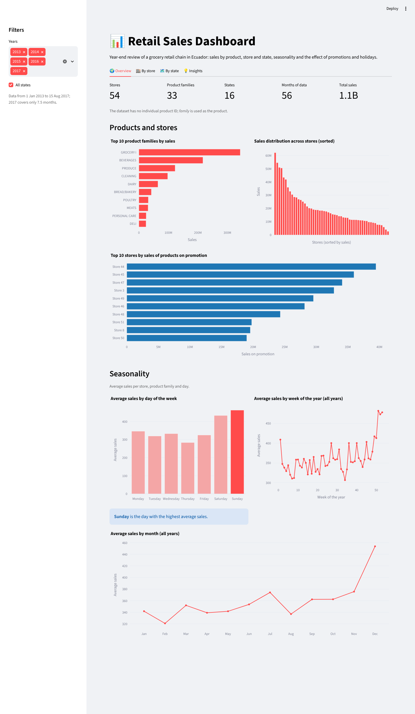
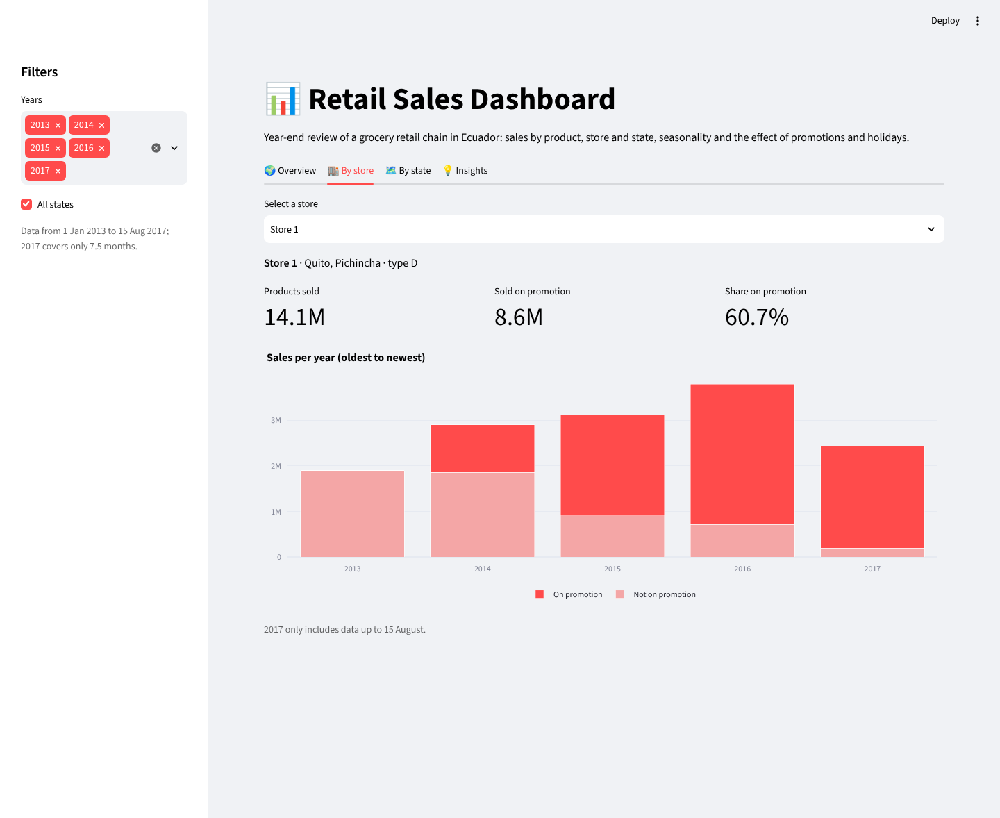
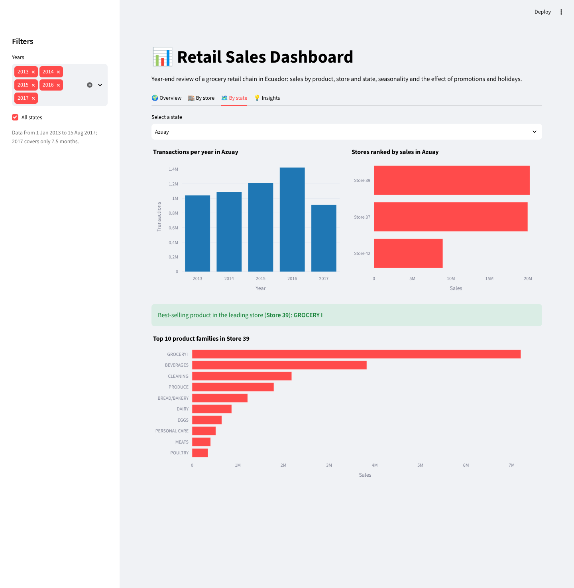
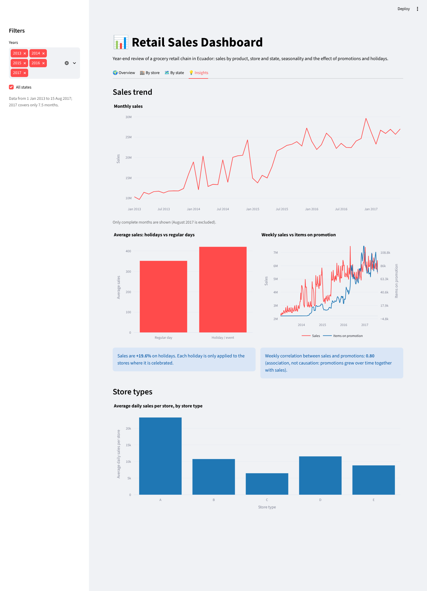

**English** | [Español](README.es.md)

# Retail Sales Dashboard

Interactive **Streamlit** dashboard with the sales KPIs of a grocery retail chain in Ecuador: **54 stores, 33 product families and 16 states, from January 2013 to August 2017** (3 million daily records). It was designed as a year-end review for the CEO and the Head of Sales.

### 👉 [Open the live dashboard](https://jimenazubii-retail-sales.streamlit.app)

> Individual final project for *Data Visualisation (Visualización de Datos)*, 2nd year of the BSc in Mathematical Engineering and Artificial Intelligence, ICAI – Universidad Pontificia Comillas (2025/26).


<p align="center">
  
</p>

---

## What the dashboard shows

The global filters in the sidebar (years and states) apply to every tab.

| Tab | Content |
|---|---|
| 🌍 **Overview** | Number of stores, product families, states and months · top 10 products · sales distribution across stores · top 10 stores by promotional sales · seasonality by day of the week, week of the year and month |
| 🏬 **By store** | Store selector · products sold in total and on promotion · yearly sales split by promotion |
| 🗺️ **By state** | State selector · transactions per year · store ranking · best-selling products of the leading store |
| 💡 **Insights** | Monthly sales trend · holidays vs regular days · weekly sales vs promotions · performance by store type |

<p align="center">
  
  
  
</p>

## Key insights

- **Weekends drive sales:** average sales on Sunday (463) are 63 % higher than on Thursday (284), the weakest day.
- **December peak:** average sales in December are 26 % above the monthly average.
- **Concentrated catalogue:** three families (*Grocery I*, *Beverages* and *Produce*) account for 64 % of all sales.
- **Very unequal stores:** the best store (no. 44) sells 23 times more than the weakest one. Type A stores average about 23,000 in daily sales, twice as much as any other type.
- **Holidays:** sales are **+19.6 %** higher on holidays and events, once each holiday is applied only where it is celebrated (see below).
- **Promotions:** weekly sales and items on promotion show a 0.80 correlation over 2013–2017, but only **0.11** within 2017. Most of the overall correlation therefore comes from both growing over time, not from a direct effect of promotions.

## Data preparation

The raw data (≈ 350 MB of CSV) has one row per store, product family and day, already joined with store information, transactions, oil prices and holidays. While building the dashboard I found three issues in that joined table and fixed them in `scripts/prepare_data.py`:

1. **Duplicated rows.** When two holidays fall on the same day, the join repeats every store–family row. That adds 53,460 extra rows and inflates total sales by 2.1 %. They are removed.
2. **Transactions counted 33 times.** `transactions` is one value per store and day, but it was repeated in each of the 33 product-family rows. Summing it gave ~1 billion transactions a year instead of the real ~30 million. It is now taken once per store and day.
3. **Holidays applied to every store.** A local holiday, such as the anniversary of the city of Puyo, was flagged as a holiday for all 54 stores in the country. Now national holidays apply to every store, regional ones only to stores in that state and local ones only to stores in that city. Transferred holidays and compensatory working days are not counted as days off. With this fix the holiday uplift changes from +11.8 % to +19.6 %.

The script then aggregates the data into two small tables: sales per *store × family × month* and per *store × day*. Each table keeps the number of underlying rows, so every average and total in the dashboard is **exactly** the same as computing it on the 3 million raw rows (checked to the decimal). The data shrinks from 350 MB to **1.6 MB**, which makes the app load in seconds and lets it run on the free Streamlit Community Cloud tier.

## Repository structure

```
retail-sales-dashboard/
├── app.py                    # Streamlit dashboard
├── scripts/
│   └── prepare_data.py       # Cleans and aggregates the raw CSVs into data/
├── data/
│   ├── sales_monthly.parquet # store × family × month
│   └── store_daily.parquet   # store × day (sales, transactions, holidays)
├── raw/                      # Raw CSVs go here (git-ignored, not redistributed)
├── docs/screenshots/         # Screenshots used in this README
├── .streamlit/config.toml    # Theme
└── requirements.txt
```

## How to reproduce the results

**Requirements:** Python 3.12.

1. **Clone the repository and install the dependencies**
   ```bash
   git clone https://github.com/jimenazubii/retail-sales-dashboard.git
   cd retail-sales-dashboard
   python3.12 -m venv .venv
   source .venv/bin/activate          # Windows: .venv\Scripts\activate
   pip install -r requirements.txt
   ```

2. **Run the dashboard**
   ```bash
   streamlit run app.py
   ```
   It opens at http://localhost:8501. The aggregated data is already in `data/`, so no download is needed.

3. **(Optional) Rebuild the data from the raw CSVs.** Place the raw files in `raw/` and run:
   ```bash
   python scripts/prepare_data.py
   ```
   Expected output: `Raw rows: 3,054,348`, `Removed duplicated rows: 53,460 -> 3,000,888 rows`, and `Total sales: 1,073,644,952 | transactions: 141,478,945`.

## Dataset

The data comes from the Kaggle competition [*Store Sales – Time Series Forecasting*](https://www.kaggle.com/competitions/store-sales-time-series-forecasting) (Corporación Favorita, Ecuador). The course provided it already joined into a single table. The raw files are not redistributed here; the repository only includes the aggregated tables needed by the dashboard.

## Author

**Jimena Zubizarreta**, BSc in Mathematical Engineering and Artificial Intelligence, ICAI – Universidad Pontificia Comillas, Madrid.
